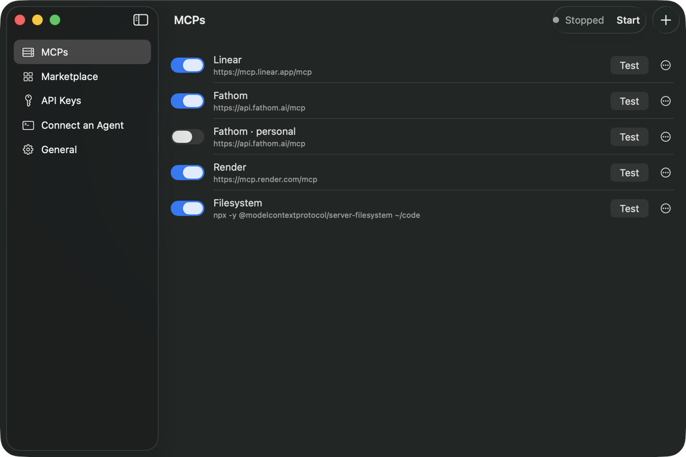
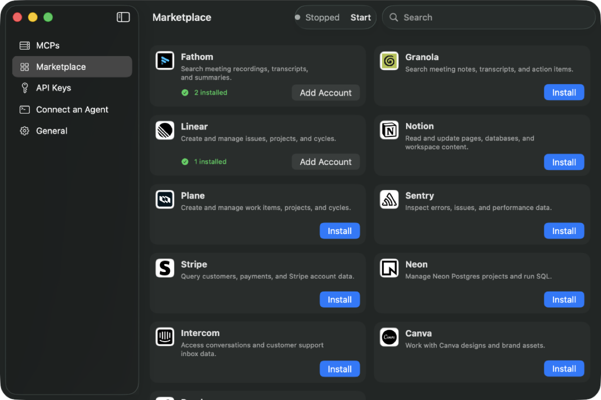

<picture>
  <source media="(prefers-color-scheme: dark)" srcset="docs/public/images/sumeru-mark-light.svg" />
  
</picture>

# sumeru

[Docs](https://pratyushchauhan.github.io/sumeru/) · [npm](https://www.npmjs.com/package/sumeru-mcp)

Formerly **funnelit**. Local desktop MCP funnel. Add N upstream MCP servers (stdio commands or HTTP URLs) and expose them through one authenticated Streamable HTTP endpoint.

<p align="center">
  
  &nbsp;
  
</p>

<p align="center"><sub>Native SwiftUI app on macOS · the Tauri app on Linux (<a href="docs/public/images/configure.png">screenshot</a>)</sub></p>

## Install

- **macOS** (Apple Silicon and Intel): download `sumeru_<version>_universal.dmg` from the [latest release](https://github.com/PratyushChauhan/sumeru/releases/latest), open it, and drag **Sumeru** to **Applications**. It's a native menu-bar app: the Sumeru icon in the menu bar shows status, copies the endpoint, and opens the main window. Sumeru isn't notarized yet, so macOS blocks the first launch: open **System Settings → Privacy & Security** and click **Open Anyway**. If it still won't open, run `xattr -dr com.apple.quarantine /Applications/Sumeru.app` in Terminal. On first launch and after updates, macOS may ask to let **sumeru** (the bundled engine) use its keychain item; enter your password and click **Always Allow** (the endpoint starts once you answer).
- **Linux**: AppImage, `.deb` or `.rpm` from the same release.
- **npm**: `npm i -g sumeru-mcp && sumeru gui` ([npm CLI](#npm-cli)).

## Develop

One Rust core, two UIs:

- **Engine** (`src-tauri/`): the gateway, OAuth, keychain, and every app command in `src-tauri/src/api.rs` (`dispatch`). `sumeru engine` serves those commands as JSON lines on stdin/stdout; `cargo build --no-default-features` builds it headless (no Tauri/WebKit).
- **macOS** (`macos/`): native SwiftUI menu-bar app (SwiftPM, builds with the Command Line Tools) that bundles the headless engine in `Contents/Helpers` and drives it over pipes.
- **Linux** (`src/`): Svelte 5 + Vite + [shadcn-svelte](https://www.shadcn-svelte.com/) in Tauri, calling the same commands through one `api` command.

```bash
npm install
npm run build:macos   # macOS: dist-macos/Sumeru.app + universal DMG
npm run test:macos    # Swift tests
npm run tauri dev     # Linux UI (or the Tauri UI on any desktop)
npm test              # JS tests; Rust: cargo test --lib (in src-tauri)
```

CI:
- PRs / manual: `.github/workflows/build.yml` uploads installers as workflow artifacts
- Push to `main`: `.github/workflows/release.yml` builds the native macOS app (`scripts/build-macos-app.sh`: SwiftUI shell in `macos/` + headless Rust engine, one ad-hoc signed universal DMG) and the Linux Tauri app, and publishes them to a [GitHub Release](https://github.com/PratyushChauhan/sumeru/releases) tagged `v__VERSION__` from `tauri.conf.json` (currently `v0.4.3`). Re-pushes with the same version update that release’s assets. Releases also include portable CLI binaries (`sumeru-v*-linux-x64`, `darwin-arm64`, `darwin-x64`) plus `.sha256` checksums. The workflow also publishes the [`sumeru-mcp`](packages/cli) npm package through npm trusted publishing (GitHub OIDC, no token secret), skipping versions already on npm.
- Bump release version in all package files: `npm run version:bump -- patch` (or `minor` / `major` / `0.2.12`)

## npm CLI

Install the launcher (downloads the matching portable binary on first run):

```bash
npm i -g sumeru-mcp
sumeru doctor
sumeru mcp-stdio   # or just: sumeru
sumeru gui         # desktop UI (on macOS: opens Sumeru.app)
sumeru servers add --name Granola --url https://mcp.granola.ai/mcp && sumeru servers login Granola
sumeru keys grant "work repo" Granola && sumeru keys token "work repo"
```

`sumeru servers …` / `sumeru keys …` let agents and scripts manage MCPs and API keys without the GUI. Every command takes `--json`. While the app runs, they go through its engine. The [CLI docs](docs/cli.md#manage-mcps-and-keys) have the full list.

Cursor / MCP host stdio config example:

```json
{
  "mcpServers": {
    "sumeru": {
      "command": "sumeru",
      "args": ["mcp-stdio"]
    }
  }
}
```

Overrides: `SUMERU_BINARY` (local binary path), `SUMERU_VERSION`, `SUMERU_CACHE_DIR`.

## Funnel endpoint

The funnel starts automatically on launch and keeps running in the menu bar (macOS) or system tray (Linux) when you close the window. Open the window from there to configure; Quit from there to stop the endpoint. Optionally enable **Open at login** / **Run at system startup** (starts hidden). Start/Stop in the UI if needed:

- URL: `http://127.0.0.1:7341/mcp`
- Auth: `Authorization: Bearer <token>` — one token per API key (**API Keys** on macOS, **Configure → Keys** on Linux). Each key is either *all MCPs except…* or *only…*; the gateway enforces it ([Scoped API keys](docs/cookbook/scoped-keys.md))
- Browser `Origin` requests are rejected
- Transport: stateless Streamable HTTP with JSON POSTs; GET `/mcp` returns a keep-alive SSE stream

**Connect an Agent** builds the install command/snippet for Claude Code, Codex, Cursor, VS Code, Gemini CLI, and Windsurf, with one-click **Add to Cursor** / **Add to VS Code** deeplinks and a **Copy prompt** you can paste into the agent so it installs itself (`src/lib/agents.js`, mirrored byte-for-byte in `macos/Sources/SumeruKit/Recipes.swift`). Pick an API key to scope it, and **This repo** for a committable project config that reads the token from an env var instead of containing it.

Example client config:

```json
{
  "mcpServers": {
    "sumeru": {
      "url": "http://127.0.0.1:7341/mcp",
      "headers": {
        "Authorization": "Bearer <token>"
      }
    }
  }
}
```

## MCP test client

Stdlib Python client that mirrors the Cursor handshake (`initialize` → `initialized` → GET SSE → `tools/list` → `tools/call`):

```bash
# Sumeru must be running on :7341
python3 scripts/mcp_test_client.py --keyring
python3 scripts/mcp_test_client.py --keyring --clients 3
python3 scripts/mcp_test_client.py --keyring --call list_mcp_tools \
  --args '{"mcp_id":"<id>"}'
```

Token can also come from `SUMERU_TOKEN` or `--token`. Exit code `0` on pass.

## Gateway tools

Sumeru exposes exactly three MCP tools:

| Tool | Inputs | Outputs |
| --- | --- | --- |
| `list_mcps` | none | configured MCP ids, names, transports, enabled flags |
| `list_mcp_tools` | `mcp_id` | upstream tool names, descriptions, schemas |
| `execute_mcp_tool` | `mcp_id`, `tool_name`, `arguments?` | upstream `CallToolResult` |

All three are scoped by the request's API key: MCPs outside it are not listed and return `unknown mcp_id`. Stdio sessions pick a key with `sumeru mcp-stdio --key <name>` (default: the Default key).

## Upstream MCP formats

- **stdio**: paste a command (e.g. `npx`) plus args/env secrets (keychain)
- **http**: paste a Streamable HTTP MCP URL

For HTTP MCPs that advertise OAuth (RFC 9728 / 8414), sumeru shows **Sign in** and opens the provider login page in your browser. Tokens are stored in the keychain.

OAuth paths:

- **DCR** — when the authorization server supports Dynamic Client Registration, Sign in registers a client automatically (no Client ID needed)
- **No DCR** — the UI shows a short guide: create an OAuth app with the provider, register redirect URI `http://127.0.0.1:7342/oauth/callback`, paste Client ID (and secret if required) under **Advanced**, then Sign in

Manual bearer/headers also stay under **Advanced**.

Plain HTTP is allowed only for loopback hosts. Remote URLs must use HTTPS.

## Marketplace

The **Marketplace** tab lists a bundled curated catalog of HTTP MCPs (`src/lib/marketplace.json`, shared by both apps). **Install** runs browser OAuth (DCR) first and only saves the MCP if sign-in succeeds. API-key providers (**Render**, marked with `apiKeyUrl`) ask for a key instead, test-connect with it, and save it to the keychain only if that works. **Add account** connects another account of an installed provider (asks for a unique name and forces a fresh provider login). Non-DCR or stdio servers stay on **Configure → Add MCP**.

## Lifecycle

- Closing the window hides the UI; the MCP funnel keeps serving from the menu bar / tray (on macOS, quitting the app closes the engine's stdin, which stops the gateway)
- Upstream clients connect lazily on first `list_mcp_tools` / `execute_mcp_tool`
- Connections are reused until Sumeru quits, the MCP is edited/deleted, or the transport closes
- Tool execution is never auto-retried after an ambiguous failure

## Storage

- Config: app config dir `/sumeru/servers.json`
- Secrets: OS keychain service `sumeru` (API key tokens — Default key: `endpoint-token`, others: `key:<id>` — plus env/header/bearer values and OAuth client + refresh tokens)

## Security notes

- Funnel binds only to `127.0.0.1`
- A bearer token for an API key is required; each key only reaches the MCPs in its scope
- Stdio commands are argv-based (no shell strings)
- Upstream tool metadata/output is untrusted data

## Codex & GPT-5.6

- **GPT-5.6 Sol** — used to plan the product and architecture (local MCP funnel, three-tool gateway, OAuth/DCR flows, tray lifecycle, Marketplace).

**Breaking (v0.1):** app id `com.sumeru.app`, config dir, keychain service `sumeru`, CLI/npm `sumeru`, and env `SUMERU_*`. Prior funnelit installs are not migrated — reconfigure or copy config/secrets manually.

**Docs:** [GitHub Pages](https://pratyushchauhan.github.io/sumeru/) · the macOS app links there (**General → Documentation**); the Linux app's **Docs** serves the same VitePress site locally at `http://127.0.0.1:7343`. Source is [`docs/`](docs/). Preview with `npm run docs:dev`.

**Linux AppImage on Wayland:** if you see `EGL_BAD_PARAMETER`, run with `LD_PRELOAD=/usr/lib/libwayland-client.so ./sumeru_*.AppImage` (or use the `.deb` / `.tar.gz`). Newer builds also re-exec with the host Wayland client automatically. See Docs → Linux.

